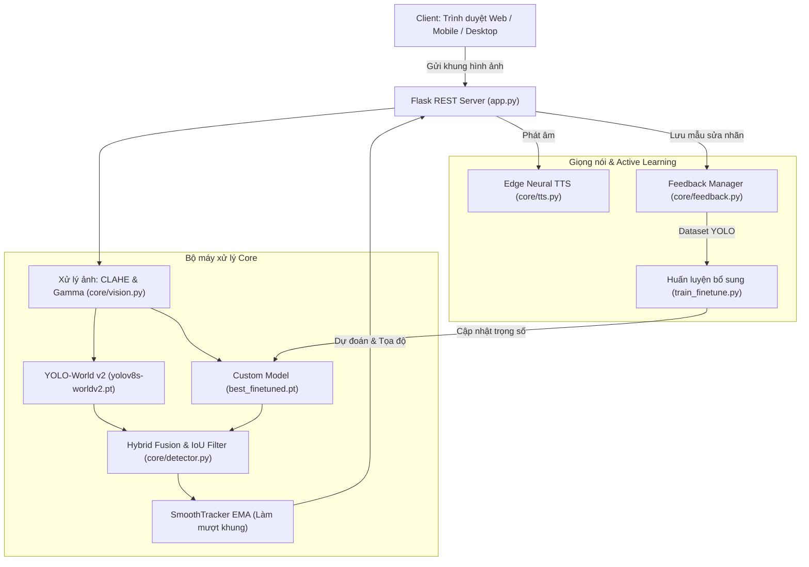

# 🚀 DAMON AI - Hệ Thống Nhận Diện Vật Thể Thời Gian Thực & Học Từ Vựng Đa Ngôn Ngữ

<p align="center">
  
  
  
  
  
  
</p>

**DAMON AI** là đồ án ứng dụng thị giác máy tính kết hợp AI đa phương thức:
1. **Nhận diện vật thể thời gian thực** (Real-time Object Detection) thông qua Camera trình duyệt (Laptop/Điện thoại) và Camera Desktop.
2. **Chế độ Flashcard học từ vựng 5 ngôn ngữ**: Tự động dịch và phát âm chuẩn bản địa qua **Microsoft Edge Neural Voice** (Việt, Anh, Trung, Hàn, Nga).
3. **Mô hình Lai (Hybrid AI Fusion)**: Kết hợp sức mạnh mở rộng của **YOLO-World v2** (Open-vocabulary) với mô hình **Fine-tuned Custom** tối ưu hóa trên dữ liệu thực tế.
4. **Vòng lặp học liên tục (Active Learning Loop)**: Cho phép người dùng trực tiếp sửa nhãn sai trên Web App và huấn luyện bổ sung (Fine-tuning) với kỹ thuật đóng băng tầng (Freeze Backbone) để tránh quên tri thức cũ.

---

## 📌 Mục Lục

- [Tính Năng Nổi Bật](#-tính-năng-nổi-bật)
- [Kiến Trúc Hệ Thống](#-kiến-trúc-hệ-thống)
- [Yêu Cầu Hệ Thống](#-yêu-cầu-hệ-thống)
- [Cài Đặt Nhanh](#-cài-đặt-nhanh)
- [Tải Trọng Số Mô Hình (Weights)](#-tải-trọng-số-mô-hình-weights)
- [Hướng Dẫn Sử Dụng](#-hướng-dẫn-sử-dụng)
  - [1. Chạy Web Server](#1-chạy-web-server)
  - [2. Huấn Luyện Bổ Sung (Fine-tuning)](#2-huấn-luyện-bổ-sung-fine-tuning)
- [Danh Sách Ngôn Ngữ Hỗ Trợ](#-danh-sách-ngôn-ngữ-hỗ-trợ)
- [Cấu Trúc Thư Mục](#-cấu-trúc-thư-mục)
- [API Reference](#-api-reference)
- [Giấy Phép](#-giấy-phép)

---

## ✨ Tính Năng Nổi Bật

- 🎯 **Nhận diện mở (Open-Vocabulary Detection)**: Phát hiện linh hoạt 30+ vật thể thường gặp với độ trễ thấp trên GPU CUDA hoặc CPU.
- ⚡ **Thuật toán Hybrid AI Fusion**: Tự động kết hợp dự đoán giữa mô hình YOLO-World và mô hình Fine-tuned dựa trên chỉ số IoU và độ tin cậy để loại bỏ các trường hợp nhận diện nhầm.
- 🗣️ **Phát âm từ vựng Neural Voice chất lượng cao**:
  - Hỗ trợ 5 ngôn ngữ với giọng đọc tự nhiên chuẩn Microsoft Edge Neural TTS.
  - Tự động fallback sang Web Speech API của trình duyệt khi ngoại tuyến.
- 👁️ **Tối ưu hóa thị giác máy tính**:
  - Tự động cân bằng sáng thích ứng CLAHE + Gamma Correction khi môi trường thiếu sáng hoặc ngược sáng.
  - Bộ lọc nội suy tọa độ **SmoothTracker (EMA)** giúp Bounding Box không bị rung lắc giữa các frame.
- 🔄 **Active Learning & Thu thập dữ liệu phản hồi**:
  - Người dùng bấm **"Sửa nhãn"** trực tiếp trên Web khi AI đoán sai.
  - Hệ thống tự động crop ảnh, gán bounding box chuẩn format YOLO `.txt` và cập nhật `data.yaml`.

---

## 🏗️ Kiến Trúc Hệ Thống



---

## 💻 Yêu Cầu Hệ Thống

- **Hệ điều hành**: Windows 10/11, Ubuntu 20.04+, hoặc macOS.
- **Python**: `>= 3.10` (khuyên dùng Python 3.10 hoặc 3.11).
- **Phần cứng**:
  - Khuyến nghị GPU NVIDIA (GTX 1650 trở lên, hỗ trợ CUDA) để đạt FPS cao (30 - 60 FPS).
  - Vẫn chạy tốt trên CPU với chế độ suy luận tối ưu.

---

## 📦 Cài Đặt Nhanh

```bash
# 1. Clone repository về máy
git clone https://github.com/haono2810/DA_AI.git
cd DA_AI

# 2. Khởi tạo môi trường ảo Python
python -m venv .venv

# Kích hoạt môi trường (Windows PowerShell):
.venv\Scripts\Activate.ps1
# (Hoặc trên Linux / macOS): source .venv/bin/activate

# 3. Cài đặt các thư viện phụ thuộc
pip install -r requirements.txt
```

---

## 📥 Tải Trọng Số Mô Hình (Weights)

Vì các file trọng số `.pt` có dung lượng lớn (> 100 MB không lưu trực tiếp trên Git repo), bạn có thể tải các mô hình nền từ Ultralytics hoặc đặt vào thư mục gốc dự án:

1. **YOLO-World v2 Models**:
   - Tải `yolov8s-worldv2.pt` hoặc `yolov8l-worldv2.pt` từ [Ultralytics Releases](https://github.com/ultralytics/assets/releases).
   - Đặt file tại thư mục gốc: `yolov8s-worldv2.pt` và `yolov8l-worldv2.pt`.
2. **Mô hình Fine-tuned (nếu có)**:
   - Đặt file đã huấn luyện vào: `weights/best_finetuned.pt`.

---

## 🚀 Hướng Dẫn Sử Dụng

### 1. Chạy Web Server

Khởi động Flask Web Application:
```bash
python app.py
```
Sau khi khởi động thành công, mở trình duyệt và truy cập:
- **Trên máy tính**: `http://localhost:5000`
- **Trên điện thoại (cùng mạng Wi-Fi)**: `http://<IP_MAY_TINH>:5000` (địa chỉ IP nội bộ được in ra trong terminal khi khởi chạy).

Giao diện Web cung cấp:
- Bật/Tắt Camera và chuyển đổi Camera trước/sau.
- Lựa chọn chế độ mô hình: **Lai (Hybrid)**, **YOLO-World**, hoặc **Mô hình đã học**.
- Tùy chỉnh thanh trượt độ nhạy (Confidence Threshold).
- Chọn ngôn ngữ học tập (Việt, Anh, Trung, Hàn, Nga) kèm phát âm chuẩn xác.
- Nút **Sửa nhãn** khi AI nhận diện chưa đúng để đóng góp mẫu cho quá trình Fine-tuning.

---

### 2. Huấn Luyện Bổ Sung (Fine-tuning)

Khi đã tích lũy đủ các mẫu phản hồi từ tính năng "Sửa nhãn", chạy script huấn luyện:

```bash
# Huấn luyện mặc định (25 epochs, batch size 8)
python train_finetune.py

# Hoặc tùy biến tham số
python train_finetune.py --epochs 30 --batch 8 --lr 0.001 --freeze 10
```

Script sẽ tự động:
- Đọc dữ liệu từ `dataset/feedback/data.yaml`.
- Đóng băng các tầng Backbone để bảo toàn khả năng nhận diện tổng quát.
- Lưu trọng số tốt nhất về `weights/best_finetuned.pt` để Web App tự động nạp.

---

## 🌐 Danh Sách Ngôn Ngữ Hỗ Trợ

| Mã | Ngôn Ngữ | Cờ | Giọng Đọc Mặc Định (Edge TTS) |
|:---|:---|:---:|:---|
| `vi` | Tiếng Việt | 🇻🇳 | `vi-VN-NamMinhNeural` |
| `en` | English | 🇬🇧 | `en-US-GuyNeural` |
| `zh` | 中文 (Trung Quốc) | 🇨🇳 | `zh-CN-YunxiNeural` |
| `ko` | 한국어 (Hàn Quốc) | 🇰🇷 | `ko-KR-SunHiNeural` |
| `ru` | Русский (Nga) | 🇷🇺 | `ru-RU-DmitryNeural` |

---

## 📂 Cấu Trúc Thư Mục

```text
DA_AI/
├── app.py                  # Điểm khởi chạy Flask Web Application & API
├── train_finetune.py       # Script huấn luyện bổ sung (Active Learning)
├── requirements.txt        # Danh sách thư viện phụ thuộc
├── CHANGELOG.md            # Nhật ký thay đổi qua từng phiên bản
├── .gitignore              # Cấu hình bỏ qua file nhị phân & môi trường ảo
├── core/                   # Các module xử lý logic nghiệp vụ
│   ├── __init__.py
│   ├── config.py           # Cấu hình Single Source of Truth, từ điển vật thể & ngôn ngữ
│   ├── detector.py         # YOLO Detector, AsyncDetector, SmoothTracker & Hybrid Fusion
│   ├── vision.py           # Cân bằng ánh sáng thích ứng CLAHE, resize ảnh
│   ├── tts.py              # Dịch vụ tổng hợp giọng nói Microsoft Edge TTS
│   ├── feedback.py         # Quản lý mẫu ảnh phản hồi, xuất chuẩn nhãn YOLO
│   ├── camera.py           # Quản lý luồng Camera đa luồng
│   └── dashboard.py        # Giao diện đồ họa OpenCV Desktop
├── static/                 # Giao diện Frontend Web App
│   ├── index.html          # Cấu trúc HTML responsive & Cyberpunk UI
│   ├── style.css           # Hiệu ứng Glassmorphism, animations
│   └── app.js              # Xử lý Camera Stream, Audio TTS, Modal Sửa nhãn
└── dataset/
    └── feedback/           # Thư mục lưu trữ dữ liệu Active Learning
        ├── annotations.json
        ├── classes.json
        ├── data.yaml
        ├── images/
        └── labels/
```

---

## 📡 API Reference

| Endpoint | Method | Mô Tả | Tham Số Chính |
|:---|:---:|:---|:---|
| `/api/predict` | `POST` | Gửi ảnh để dự đoán vật thể | `file` (multipart), `conf`, `model`, `enhance` |
| `/api/classes` | `GET` | Danh sách các lớp vật thể & ngôn ngữ | Không |
| `/api/feedback` | `POST` | Lưu mẫu sửa nhãn phục vụ huấn luyện | `file`, `label`, `box` (JSON x1,y1,x2,y2) |
| `/api/tts` | `GET` | Trả về file âm thanh phát âm từ vựng | `text`, `lang` (`vi`, `en`, `zh`, `ko`, `ru`) |

---

## 📄 Giấy Phép

Dự án được phân phối dưới giấy phép **MIT License**. Mọi đóng góp và tái sử dụng đều được hoan nghênh.
